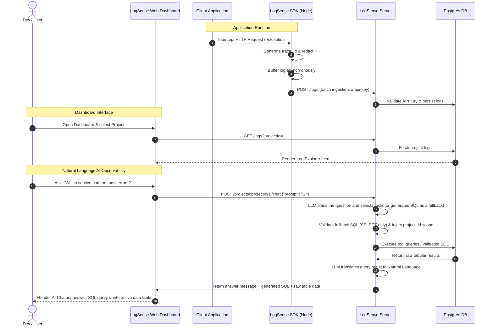

# 📊 LogSense Web Dashboard


LogSense is an AI-powered developer observability platform that turns raw logs and metrics into meaningful system insights. This repository contains the Next.js frontend dashboard—a clean, premium, and fully responsive user interface for monitoring log traffic, tracking system performance, managing projects/API keys, and querying your logs in plain English using conversational AI.

---


## 🏗️ Architecture Overview

The LogSense platform is composed of three primary components working together:

1. **LogSense SDK (`logsense-sdk-node`)**: Middleware integrated into client applications (e.g. Express) to automatically collect requests, responses, performance metrics, and error stack traces. It redacts sensitive data locally and flushes logs asynchronously in batches.
2. **LogSense Server (`logsense-server`)**: Fastify-based backend server. It hosts the ingestion API to receive log batches, validates API keys, handles project-level authentication, and runs an AI log agent (via a local Ollama server) that answers natural-language questions using log/metric/trace tools, with a validated read-only SQL fallback.
3. **LogSense Web (`logsense-web`)**: Next.js (App Router) observability dashboard. It communicates with the backend via REST endpoints to display system health metrics, manage credentials, explore logs, and host the AI Query interface.

### Request and Ingestion Flow



---

## ✨ Features

### 1. Unified Observability Dashboard
- **Key Metrics Grid**: Live tracking of **Total Log Lines**, **Error Events**, **Error Rate (%)**, and **Average Latency (ms)**.
- **Log Volume Timeline**: An interactive custom SVG area chart displaying request volume trends and error spikes over time.
- **Severity Breakdown**: Color-coded progress bars reflecting distribution details of `debug`, `info`, `warn`, and `error` severities.
- **Service Health Performance**: Track requests, average latencies, and error tallies aggregated by individual microservices.

### 2. Live Log Explorer
- **Real-Time Feed**: Continuously tailing logs with optional 5-second polling (Live Tail toggle).
- **Search & Filters**: Instantly filter logs by raw message text, trace ID, user ID, log severity levels, microservice scope, and environments (development, staging, production).
- **Slide-Out Inspector Drawer**: Click any log to open a sidebar drawer displaying detailed fields, hostname, formatted timestamps, and the full nested JSON metadata payload (e.g. status codes, headers, and request/response payloads).
- **Trace Correlation**: Trace logs across multiple services. Click **"Find Traces"** inside any log drawer to filter the entire feed to only logs sharing that trace ID.

### 3. AI Query Assistant
- **Conversational Queries**: Interrogate your logs using plain English (e.g., *"Which endpoint is slowest?"*, *"Analyze errors today"*, *"Compare staging vs production error counts"*).
- **Interactive Execution Lifecycle**: Watch the AI step through parsing, SQL generation, safe scoping validation, execution, and translation.
- **Explainable SQL**: The generated read-only SQL query is printed inline alongside database results for full transparency.
- **Raw Data Grid**: A dynamically rendered tabular results view displays raw columns directly returned from the database query.

### 4. Log Explorer Extras
- **Trace Waterfall** (`components/TraceWaterfall.tsx`): timeline view of the spans/logs sharing a trace ID, coloured per service.
- **Log Minimap** (`components/LogMinimap.tsx`): compact overview of the log feed for quick navigation.
- **Pattern Intelligence** (`components/LogPatternIntelligence.tsx`): groups similar log messages into patterns.
- **AI Log Analyzer** (`components/AiLogAnalyzer.tsx`): explains a single log event (and suggests fixes for errors) by sending it to the AI chat endpoint; the answer is rendered as Markdown.

### 5. Active Users Map
- The **Active Users** page plots user/onboarding activity from `GET /dashboard/onboarding` on a Leaflet map, with filtering, search and polling.

### 6. Projects & Settings
- **Project detail** page with SDK integration snippets that use the configured API URL.
- **Settings** page with profile and password management, Discord webhook alert integration, and log retention days.

### 7. API Key & Environment Scoping
- **Scoped Credentials**: Generate API keys specifically bound to environments (`development`, `staging`, `production`).
- **Access Controls**: Toggle API key active states instantly to enable or disable ingestion endpoints.
- **Security Protections**: Sensitive keys are displayed in plain-text only once upon generation and are masked permanently afterward.
- **Rotation & Revocation**: Rotate active keys with warning dialogs, or delete them to block unauthorized traffic immediately.

---

## 🛠️ Technology Stack

| Library / Tool | Purpose | Key Details |
| :--- | :--- | :--- |
| **Next.js 16** | Core Web Framework | App Router, Dynamic Pages, Layout Scopes |
| **React 19 & TypeScript** | Component Library & Typing | Strict static types, custom hooks, reactive state |
| **TanStack React Query v5** | Server State Management | Cache invalidation, automated polling, request deduplication |
| **Zustand** | Client State Management | Fast, lightweight global stores for Authentication and Project state |
| **Tailwind CSS v4** | Component Styling | Sleek dark-mode theme, custom blur glows, transitions |
| **Axios** | HTTP client | Interceptors for attaching JWT auth headers, token refresh on 401, default baseURL |
| **Lucide React** | Icon Suite | Modern SVG micro-icons for dashboard navigation |
| **React Hook Form + Zod** | Form handling & Validation | Strong validation for API keys and Project forms |
| **Leaflet** | Maps | Active Users map |
| **react-markdown + remark-gfm** | Markdown rendering | AI answers |
| **Sonner** | Toasts | Notifications |

---

## 🚀 Getting Started

### 📋 Prerequisites
- **Node.js**: `v18.x` or later (recommended `v20+`)
- **Package Manager**: `npm` (default), `yarn`, or `pnpm`

### 🔧 Installation & Setup

1. **Clone the repository** and enter it:
   ```bash
   cd logsense-web
   ```

2. **Install project dependencies**:
   ```bash
   npm install
   ```

3. **Configure Environment Variables**:
   Create a `.env.local` file in the root of the project:
   ```env
   NEXT_PUBLIC_API_URL=<url of your logsense-server, e.g. http://localhost:5000>
   ```
   *`NEXT_PUBLIC_API_URL` is the only environment variable used; it is the Axios base URL for all API calls and is also shown in the SDK setup snippets.*

4. **Start the local development server**:
   ```bash
   npm run dev
   ```
   Open [http://localhost:3000](http://localhost:3000) in your browser to view the application.

### 📦 Production Build

To compile a production bundle and run the server:
```bash
# Compile and build the Next.js client
npm run build

# Start the compiled client server
npm run start
```

### Other scripts

```bash
npm run lint   # eslint
```

No test script is defined.

> This project uses Next.js 16, which has breaking changes from earlier versions. Contributors (and coding agents — see `AGENTS.md`) should consult the docs bundled in `node_modules/next/dist/docs/` rather than older Next.js conventions.

---

## 📁 Project Structure

```
app/
  (auth)/login/            Login / register
  (dashboard)/dashboard/   Metrics overview
  (dashboard)/logs/        Log Explorer
  (dashboard)/projects/    Project list and detail ([id])
  (dashboard)/api-keys/    API key management
  (dashboard)/active-users/ Active Users map
  (dashboard)/settings/    Profile, alerts, retention
components/                Log explorer widgets, AI analyzer, layout (sidebar, navbar, chatbot drawer), Leaflet map
hooks/use-auth.ts          Auth hook
lib/                       Axios instance (auth + refresh interceptors), typed API client, React Query client
store/                     Zustand stores (auth, selected project)
types/                     Shared API types
```
